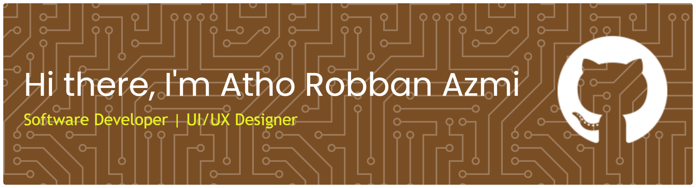

## Hi there, I'm Atho Robban Azmi 👋

##### Software Developer | UI/UX Designer | Cyber Security | Marketing Agent

<!--
**Athorobban/AthoRobban** is a ✨ _special_ ✨ repository because its `README.md` (this file) appears on your GitHub profile.

Here are some ideas to get you started:

- 🔭 I’m currently working on ...
- 🌱 I’m currently learning ...
- 👯 I’m looking to collaborate on ...
- 🤔 I’m looking for help with ...
- 💬 Ask me about ...
- 📫 How to reach me: ...
- 😄 Pronouns: ...
- ⚡ Fun fact: ...
-->

I am a multidisciplinary professional dedicated to creating innovative, secure, and user-centric technological solutions. Starting from a strong foundation as a **Software Developer**, I have expanded my expertise into the realms of **UI/UX Design**, **Cyber Security**, and **Marketing**. I thrive on analyzing complex problems and transforming them into modern web applications that feature beautiful interfaces backed by a robust and secure infrastructure.

## 🚀 Tech Stack

#### **Frontend**

#### **Backend & Database**

#### **Tools & Design**

## 📌 Featured Projects

#### 🔹 **AI Chatbot for E-Learning SD**

A full-stack e-learning website with an integrated AI assistant that helps students learn interactively.  
**Tech:** Next.js, Supabase Auth, Supabase, Gemini API, Tailwind

#### 🔹 **📈 Financial-Notes-App (Finnotes-App)**

A comprehensive, full-stack financial management application that integrates artificial intelligence to provide deep financial insights.

  **- AI Integration**: Utilizes the Gemini AI API to automatically generate financial insight reports, provide personalized savings guidance, and offer an     interactive chatbot feature.

  **- Security & Infrastructure**: Equipped with an authentication proxy and middleware rules to safeguard application routes. It features custom database authentication scripts to manage role-based access control (Admin and User) securely within Supabase.

  **- Data Management**: Leverages Supabase storage buckets for the secure and efficient management of user file uploads.

#### 🔹 **🎓 E-Learning Eduvance**

An interactive e-learning platform designed with modern architecture to deliver an optimal teaching and learning experience.

  **- Core Technology**: Built using the Next.js App Router and Supabase database to ensure fast, reliable, and scalable performance.

  **- UI/UX & Design**: Implements a sleek, modern interface utilizing Shadcn UI components and custom sidebar layouts. Features highly interactive and validated form designs (for quizzes and assignments) using React Hook Form and Zod.

  **- Smart Features**: Integrated with an AI-driven report panel that provides performance analytics and valuable learning insights for both students and educators.

## 🧩 UI/UX Showcase

Here are some of my design concepts and component systems:

🎨 Design Systems  
📱 Mobile UI Exploration  
💻 Dashboard Layouts  
✏ Wireframes & Prototypes

## 📬 Connect With Me

## ☕ Support My Work

If you like what I build, consider giving a ⭐ on my projects!
